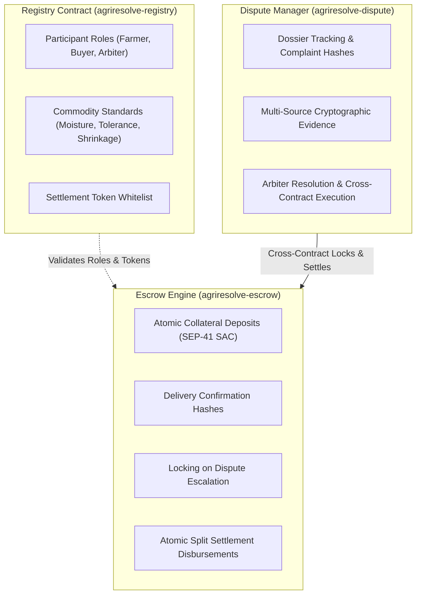
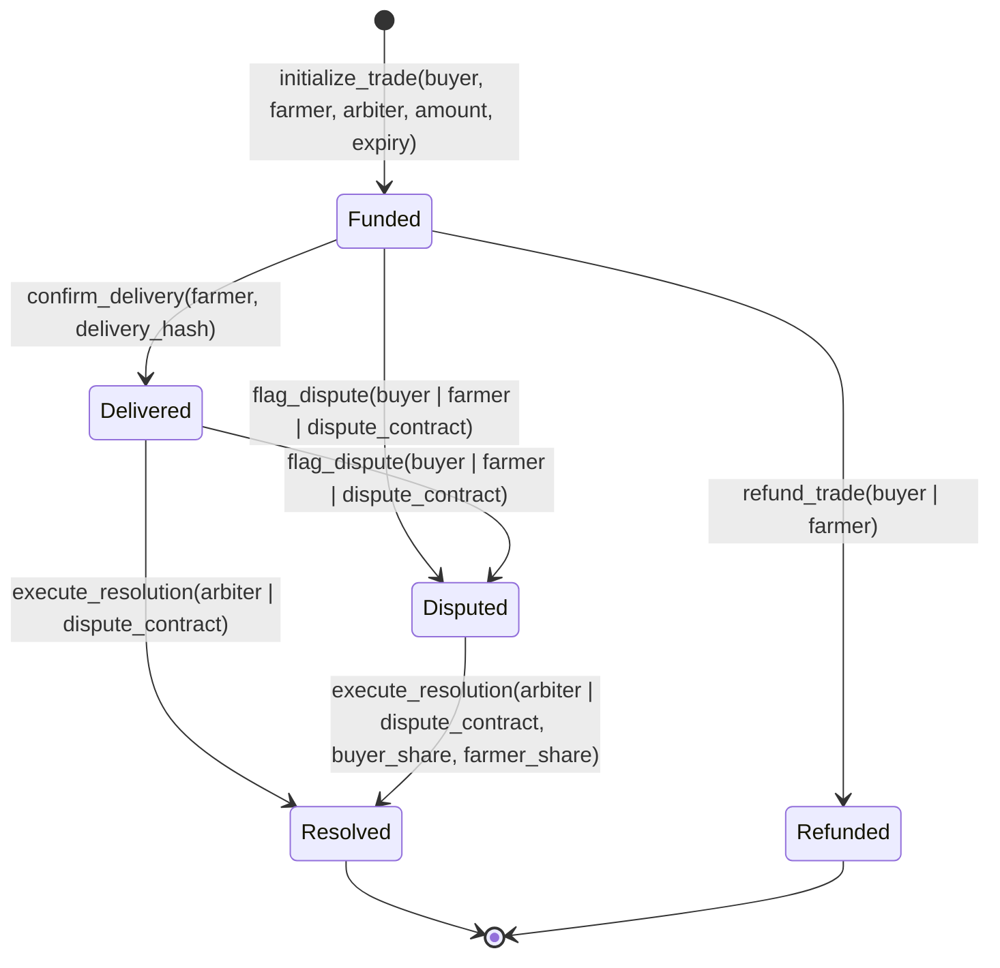

# AgriResolve Smart Contracts

[](https://github.com/AgriResolve/AgriResolve-contract/actions/workflows/ci.yml)
[](LICENSE)
[](https://soroban.stellar.org/)
[](https://stellar.org/)
[](https://www.rust-lang.org/)

Pure Rust Soroban smart contract workspace powering **AgriResolve** — a decentralized agricultural trade finance, quality registry, and autonomous dispute resolution protocol on the Stellar network.

---

## Deployed Testnet Contracts

| Contract Name | Contract ID | Stellar.Expert Explorer | Status |
|---|---|---|---|
| `agriresolve-registry` | `CC3OJZP4DCYOOTRJTT66UHMAGR2677JNDBNFQYMREQA2ONDWNRAO75J6` | [View on Stellar.Expert](https://stellar.expert/explorer/testnet/contract/CC3OJZP4DCYOOTRJTT66UHMAGR2677JNDBNFQYMREQA2ONDWNRAO75J6) | Active (Testnet) |
| `agriresolve-escrow` | `CCPZFPNUQGNT5O6H3VWT2H23CLXF2POF5QYDAD4HPOB2RRKSHO63OIXC` | [View on Stellar.Expert](https://stellar.expert/explorer/testnet/contract/CCPZFPNUQGNT5O6H3VWT2H23CLXF2POF5QYDAD4HPOB2RRKSHO63OIXC) | Active (Testnet) |
| `agriresolve-dispute` | `CCBQBMQFQPRRMOQLPNYSIBGTL7AOXXQAAIADXE2YYTZHSUSDS6Z4ES5N` | [View on Stellar.Expert](https://stellar.expert/explorer/testnet/contract/CCBQBMQFQPRRMOQLPNYSIBGTL7AOXXQAAIADXE2YYTZHSUSDS6Z4ES5N) | Active (Testnet) |

---

## Architecture Overview

The workspace is architected as a pure Rust multi-contract cargo workspace consisting of three tightly coupled, single-responsibility contracts:

```
AgriResolve-contract/
├── .github/
│   └── workflows/
│       └── ci.yml
├── contracts/
│   ├── registry/       # Participant identity & commodity specifications
│   │   ├── Cargo.toml
│   │   └── src/
│   │       ├── lib.rs
│   │       ├── storage.rs
│   │       ├── errors.rs
│   │       ├── events.rs
│   │       └── test.rs
│   ├── escrow/         # Multi-party collateral custody & atomic split payouts
│   │   ├── Cargo.toml
│   │   └── src/
│   │       ├── lib.rs
│   │       ├── storage.rs
│   │       ├── errors.rs
│   │       ├── events.rs
│   │       └── test.rs
│   └── dispute/        # Evidence dossiers, cryptographic proofs & cross-contract arbitration
│       ├── Cargo.toml
│       └── src/
│           ├── lib.rs
│           ├── storage.rs
│           ├── errors.rs
│           ├── events.rs
│           └── test.rs
├── scripts/
│   ├── deploy_testnet.sh
│   └── create_issues.sh
├── Cargo.toml
├── Makefile
├── .gitignore
├── CONTRIBUTING.md
├── SECURITY.md
└── README.md
```

---

## Contract Responsibilities



### 1. `contracts/registry` (`agriresolve-registry`)
- **Participant Directory:** Registers Farmer, Buyer, Arbiter, and Inspector profiles with IPFS metadata URI and active status flags.
- **Commodity Standards:** Stores standardized crop specifications (e.g. White Maize base moisture 12.00%, maximum moisture 15.00%, delivery tolerance 5.00%, shrinkage factor 1.25%).
- **Token Whitelist:** Governs authorized SEP-41 settlement stablecoins (USDC, EURC, etc.).

### 2. `contracts/escrow` (`agriresolve-escrow`)
- **Atomic Custody:** Deposits funds from buyer directly into contract custody via built-in SAC `token::Client`.
- **State Machine:** Enforces valid state transitions: `Funded` $\rightarrow$ `Delivered` $\rightarrow$ `Disputed` $\rightarrow$ `Resolved` / `Refunded`.
- **Conservation of Balances:** Invariant guarantees $\text{buyer\_share} + \text{farmer\_share} == \text{trade.amount}$. Contract balance is strictly zero after resolution.
- **Cross-Contract Interoperability:** Permits authorized `dispute_contract` to lock funds upon dispute opening and execute settlements.

### 3. `contracts/dispute` (`agriresolve-dispute`)
- **Dossier Management:** Records dispute reason hashes, claimant, defendant, and arbiter identities.
- **Evidence Pipeline:** Submits multi-source cryptographic evidence hashes (weighbridge receipts, moisture analysis reports, phytosanitary certificates).
- **Settlement Bridge:** Receives AI/arbiter resolution proofs and atomically invokes `execute_resolution` on the escrow contract.

---

## Escrow State Machine



---

## Strongly Typed Events (`#[contractevent]`)

All contracts utilize Soroban SDK v29's modern `#[contractevent]` macro to guarantee type-safe, indexed event emission:

| Contract | Event Name | Topics | Data Payload |
|---|---|---|---|
| `registry` | `ParticipantRegistered` | `participant: Address` | `role: u32`, `metadata_uri: String` |
| `registry` | `ParticipantStatusUpdated` | `participant: Address` | `is_active: bool` |
| `registry` | `CommoditySpecRegistered` | `commodity_id: Symbol` | `base_moisture_bps`, `max_moisture_bps` |
| `registry` | `TokenWhitelistUpdated` | `token: Address` | `is_approved: bool` |
| `escrow` | `TradeInitialized` | `trade_id: u64` | `buyer`, `farmer`, `token`, `amount`, `expiry` |
| `escrow` | `DeliveryConfirmed` | `trade_id: u64` | `farmer: Address`, `delivery_hash: BytesN<32>` |
| `escrow` | `DisputeFlagged` | `trade_id: u64` | `caller: Address` |
| `escrow` | `ResolutionExecuted` | `trade_id: u64` | `arbiter: Address`, `buyer_share`, `farmer_share` |
| `escrow` | `TradeRefunded` | `trade_id: u64` | `recipient: Address`, `amount: i128` |
| `dispute` | `DisputeOpened` | `dispute_id: u64` | `escrow_id`, `claimant`, `complaint_hash` |
| `dispute` | `EvidenceSubmitted` | `dispute_id: u64` | `evidence_index`, `submitter`, `evidence_type`, `evidence_hash` |
| `dispute` | `DisputeResolved` | `dispute_id: u64` | `escrow_id`, `arbiter`, `buyer_share`, `farmer_share`, `resolution_hash` |
| `dispute` | `DisputeDismissed` | `dispute_id: u64` | `escrow_id`, `arbiter` |

---

## Autonomous AI Agent & Proof Bridge Integration

The contracts are designed to interface seamlessly with the AgriResolve off-chain autonomous investigation agent (`services/ai_agent/proof_bridge.py`):

1. **Dispute Ingestion:** Agent monitors `DisputeOpened` events from `agriresolve-dispute`.
2. **Provenance & Evidence Reconciliation:** Agent audits weighbridge receipts, moisture sensor logs, and purchase order clauses.
3. **Cryptographic Proof Emission:** Agent computes evidence hashes and economic loss adjustments (e.g. 60% buyer refund for moisture shrinkage).
4. **On-Chain Settlement Dispatch:** Formats parameters for `resolve_dispute`:
```python
contract_call_params = {
    "dispute_id": proof.dispute_id,
    "buyer_share": proof.buyer_share,
    "farmer_share": proof.farmer_share,
    "resolution_hash": proof.auditor_signature,
}
```

---

## Local Development & Testing

### Prerequisites
- [Rust toolchain](https://www.rust-lang.org/) (1.84+ stable)
- `wasm32v1-none` target: `rustup target add wasm32v1-none`
- [Stellar CLI](https://developers.stellar.org/docs/tools/developer-tools/cli): `cargo install --locked stellar-cli`

### Running Tests
Execute the comprehensive 18-test suite across all workspace members:
```bash
cargo test
# or using Makefile:
make test
```

### Checking Lints & Formatting
```bash
make fmt-check
make clippy
```

### Building WASM Binaries
Compile release WASM binaries with LTO optimization:
```bash
make build-wasm
# or using Stellar CLI:
stellar contract build
```

Binary sizes (all under 13 KB):
- `agriresolve_registry.wasm`: **9.7 KB**
- `agriresolve_escrow.wasm`: **11.6 KB**
- `agriresolve_dispute.wasm`: **12.5 KB**

---

## Stellar Testnet Deployment

To deploy all three contracts to Stellar Testnet and configure cross-contract linking:

```bash
# 1. Ensure you have a funded testnet identity:
stellar keys generate --network testnet agriresolve-admin
stellar keys fund agriresolve-admin --network testnet

# 2. Run automated deployment script:
./scripts/deploy_testnet.sh
```

The script will:
1. Build optimized WASM binaries.
2. Deploy Registry, Escrow, and Dispute contracts.
3. Initialize administrative identities.
4. Link `agriresolve-dispute` authorization inside `agriresolve-escrow`.
5. Write contract IDs to `.env.contracts`.

---

## Drips Wave Repository Hygiene & Issues

To seed community contributor issues adhering to Drips Wave standards:
```bash
./scripts/create_issues.sh
```

---

## Maintainers

| Name | Role | GitHub | Telegram |
|---|---|---|---|
| **Hassan Korey** | Protocol Architect & Lead Developer | [@HassanKorey](https://github.com/HassanKorey) | [@HassanKorey](https://t.me/HassanKorey) |

---

## Contributors

Thanks goes to these wonderful people:

<a href="https://github.com/AgriResolve/AgriResolve-contract/graphs/contributors">
  
</a>

---

## License

This project is open-source software licensed under the [MIT License](LICENSE).
